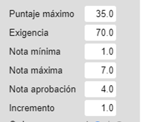
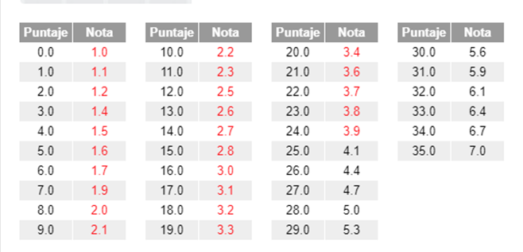

# Rúbrica de evaluación Etapa 1

<!-- Copia de consulta derivada de ../originales/02_rubrica_etapa_1.docx. El DOCX original es la fuente canónica. -->

## INTEGRACION DE COMPETENCIAS II

## Ingeniería en Informática

Rúbrica Etapa 1.-

| Nombre del evaluado |   | Fecha de observación (dd/mm/aaaa) |   |
| --- | --- | --- | --- |
| Carrera/ Sede | Analista Programador – San Joaquin | Fecha de observación (dd/mm/aaaa) |   |
| Sección/ Jornada |   | Fecha de observación (dd/mm/aaaa) |   |
| Evaluador |   | Fecha de observación (dd/mm/aaaa) |   |
| Evidencias para evaluar | Especialidad: Entregable de solución informática para un problema de mediana complejidad Empleabilidad: Informe que dé cuenta de las etapas del problema complicados y trabajo colaborativo | Especialidad: Entregable de solución informática para un problema de mediana complejidad Empleabilidad: Informe que dé cuenta de las etapas del problema complicados y trabajo colaborativo | Especialidad: Entregable de solución informática para un problema de mediana complejidad Empleabilidad: Informe que dé cuenta de las etapas del problema complicados y trabajo colaborativo |
| Subcompetencia | CE2N2: Desarrollar software en base a los requerimientos del cliente velando por la calidad, seguridad y el cumplimiento de estándares de lenguajes y metodologías de desarrollo definidos en el proyecto informático CEMN2: Trabajar colaborativamente en la adaptación o generación de soluciones a problemas propios de su área de especialización, considerando parámetros establecidos y la innovación para la optimización de procesos, productos o servicios con iniciativa y autonomía, desde la perspectiva de la ética y las competencias de sello valórico institucionales. | CE2N2: Desarrollar software en base a los requerimientos del cliente velando por la calidad, seguridad y el cumplimiento de estándares de lenguajes y metodologías de desarrollo definidos en el proyecto informático CEMN2: Trabajar colaborativamente en la adaptación o generación de soluciones a problemas propios de su área de especialización, considerando parámetros establecidos y la innovación para la optimización de procesos, productos o servicios con iniciativa y autonomía, desde la perspectiva de la ética y las competencias de sello valórico institucionales. | CE2N2: Desarrollar software en base a los requerimientos del cliente velando por la calidad, seguridad y el cumplimiento de estándares de lenguajes y metodologías de desarrollo definidos en el proyecto informático CEMN2: Trabajar colaborativamente en la adaptación o generación de soluciones a problemas propios de su área de especialización, considerando parámetros establecidos y la innovación para la optimización de procesos, productos o servicios con iniciativa y autonomía, desde la perspectiva de la ética y las competencias de sello valórico institucionales. |

| Puntaje total | Puntaje de corte | Puntaje obtenido | Nota | Ponderación |
| --- | --- | --- | --- | --- |
| 35 | 25 |   |   | CE4N2, 70% CEMN2, 30% |

Rúbrica Hito 2 etapa 1

| Criterios | CE2N2: Desarrollar software en base a los requerimientos del cliente velando por la calidad, seguridad y el cumplimiento de estándares de lenguajes y metodologías de desarrollo definidos en el proyecto informático | CE2N2: Desarrollar software en base a los requerimientos del cliente velando por la calidad, seguridad y el cumplimiento de estándares de lenguajes y metodologías de desarrollo definidos en el proyecto informático | CE2N2: Desarrollar software en base a los requerimientos del cliente velando por la calidad, seguridad y el cumplimiento de estándares de lenguajes y metodologías de desarrollo definidos en el proyecto informático | CE2N2: Desarrollar software en base a los requerimientos del cliente velando por la calidad, seguridad y el cumplimiento de estándares de lenguajes y metodologías de desarrollo definidos en el proyecto informático | Puntaje |
| --- | --- | --- | --- | --- | --- |
| Criterios | Niveles de desempeño | Niveles de desempeño | Niveles de desempeño | Niveles de desempeño | Puntaje |
| Criterios | Sobresaliente (7pts.) | Destacado (6pts.) | Competente (5pts.) | Insuficiente (0pts.) | Puntaje |
| Condiciones del proceso CE2N2 | Programa el prototipo de SW: -Considerando los requerimientos recibidos. -Resolviendo la problemática planteada -Utilizando los estándares de la empresa o la industria. -Identificando errores. -Realizando pruebas rigurosas para asegurar calidad del producto. -Entregando antes del tiempo estipulado. | Programa el prototipo de SW: -Considerando los requerimientos recibidos. -Resolviendo la problemática planteada -Utilizando los estándares de la empresa o la industria. -Identificando errores. -Realizando pruebas rigurosas para asegurar calidad del producto. | Programa el prototipo de SW: -Considerando los requerimientos recibidos -Resolviendo la problemática planteada -Utilizando los estándares de la empresa o la industria. -Identificando errores. | No programa el prototipo de SW y/o no procede: -Considerando los requerimientos recibidos. -Resolviendo la problemática planteada -Utilizando los estándares de la empresa o la industria. |   |
| Desempeño acciones CE2N2 | Desarrolla el software en base a las siguientes acciones: -Usando componentes gráficos de aplicación. -Generando documentación interna y externa. -Construyendo pruebas unitarias. | Desarrolla el software en base a las siguientes acciones: -Usando componentes gráficos de aplicación. -Generando documentación interna y externa. | Desarrolla el software en base a las siguientes acciones: -Usando componentes gráficos de aplicación. | No desarrolla el softaware y/o no procede: -Usando componentes gráficos de aplicación. |   |
| Cumplimiento de estándares CE2N2 | Cumple estándares en el desarrollo del SW: -Presentando la lógica desarrollada por el software. -Satisfaciendo las necesidades de clientes internos externos. -Aplicando estándares de documentación de proceso y códigos establecidos. -Garantizando una alta calidad del código y la arquitectura del programa. | Cumple estándares en el desarrollo del SW: -Presentando la lógica desarrollada por el software. -Satisfaciendo las necesidades de clientes internos externos. -Aplicando estándares de documentación de proceso y códigos establecidos. | Cumple estándares en el desarrollo del SW: -Presentando la lógica desarrollada por el software. -Satisfaciendo las necesidades de clientes internos externos. | No cumple estándares en el desarrollo del SW y/o no procede: -Presentando la lógica desarrollada por el software. -Satisfaciendo las necesidades de clientes internos externos. |   |

|   | CEMN2: Trabajar colaborativamente en la adaptación o generación de soluciones a problemas propios de su área de especialización, considerando parámetros establecidos y la innovación para la optimización de procesos, productos o servicios con iniciativa y autonomía, desde la perspectiva de la ética y las competencias de sello valórico institucionales. | CEMN2: Trabajar colaborativamente en la adaptación o generación de soluciones a problemas propios de su área de especialización, considerando parámetros establecidos y la innovación para la optimización de procesos, productos o servicios con iniciativa y autonomía, desde la perspectiva de la ética y las competencias de sello valórico institucionales. | CEMN2: Trabajar colaborativamente en la adaptación o generación de soluciones a problemas propios de su área de especialización, considerando parámetros establecidos y la innovación para la optimización de procesos, productos o servicios con iniciativa y autonomía, desde la perspectiva de la ética y las competencias de sello valórico institucionales. | CEMN2: Trabajar colaborativamente en la adaptación o generación de soluciones a problemas propios de su área de especialización, considerando parámetros establecidos y la innovación para la optimización de procesos, productos o servicios con iniciativa y autonomía, desde la perspectiva de la ética y las competencias de sello valórico institucionales. |   |
| --- | --- | --- | --- | --- | --- |
| Criterios | Niveles de desempeño | Niveles de desempeño | Niveles de desempeño | Niveles de desempeño | Puntaje |
| Criterios | Sobresaliente (7pts.) | Destacado (6pts.) | Competente (5pts.) | Insuficiente (0pts.) | Puntaje |
| Resolución de problema | El informe evidencia un proceso deductivo o inductivo: Argumentando tres posibles causas de la problemática y da cuenta de la estrategia utilizada para determinar el problema presentado. Identificando elementos para determinan que el problema es complicado. Argumentando la solución, siendo coherente con los antecedentes presentados Proporcionando ideas y/o comentarios de acciones preventivas para abordar problemas similares. | El informe evidencia un proceso deductivo o inductivo: Argumentando dos posibles causas de la problemática y da cuenta de la estrategia utilizada para determinar el problema presentado. Identificando elementos para determinan que el problema es complicado. Argumentando la solución, siendo coherente con los antecedentes presentados. | El informe evidencia un proceso deductivo o inductivo: Argumentando al menos una posible causa de la problemática y da cuenta de la estrategia utilizada para determinar el problema presentado. Identificando elementos para determinan que el problema es complicado. | El informe no evidencia un proceso deductivo o inductivo y/o no procede: Argumentando al menos una posible causa de la problemática y da cuenta de la estrategia utilizada para determinar el problema presentado. Identificando elementos para determinan que el problema es complicado. |   |
| Trabajo Colaborativo: Comunicación | Entrega al menos tres beneficios que se obtienen al establecer metas y objetivos claros y específicos que reflejan las necesidades y aspiraciones de un equipo. Entrega al menos tres acciones para fomentar la comunicación efectiva entre los miembros del equipo. Identifican al menos tres acciones para promover la coordinación y el compromiso en el equipo. | Entrega al menos dos beneficios que se obtienen al establecer metas y objetivos claros y específicos que reflejan las necesidades y aspiraciones de un equipo. Entrega al menos dos acciones para fomentar la comunicación efectiva entre los miembros del equipo. Identifican al menos dos acciones para promover la coordinación y el compromiso en el equipo. | Entrega al menos un beneficio que se obtienen al establecer metas y objetivos claros y específicos que reflejan las necesidades y aspiraciones de un equipo. Entrega al menos una acción para fomentar la comunicación efectiva entre los miembros del equipo. Identifican al menos una acción para promover la coordinación y el compromiso en el equipo. | No entrega ideas o beneficios que establezca el concretar metas y objetivos comunes claros. Las ideas o acciones que entrega para fomentar la comunicación entre los miembros del equipo no corresponden a comunicación efectiva. No identifican acciones para promover la coordinación y el compromiso en el equipo. |   |

Observaciones:

## Recursos gráficos incorporados

