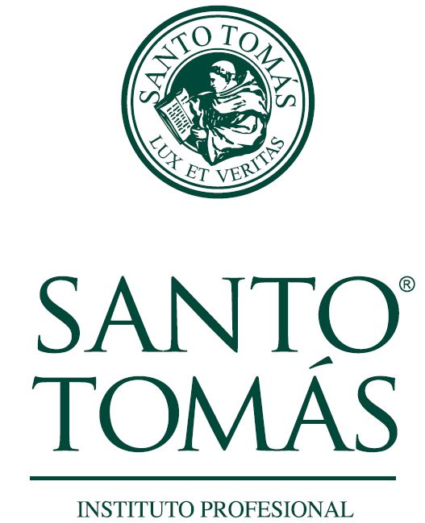

# Pauta 1.4 Avance 3

<!-- Copia de consulta derivada de ../originales/05_pauta_1_4_avance_3.docx. El DOCX original es la fuente canónica. -->

## Integración De Competencias Ii

Pauta de actividad: 1.4: Avance #3

- ANTECEDENTES GENERALES

| Recinto: | Laboratorio. |
| --- | --- |
| Competencia: | CE2N2: Desarrollar software en base a los requerimientos del cliente velando por la calidad, seguridad y el cumplimiento de estándares de lenguajes y metodologías de desarrollo definidos en el proyecto informático |
| Criterios de evaluación: |   |

- PRESENTACIÓN DE LA ACTIVIDAD

Esta semana se deberá programar el prototipo del sistema siguiendo los principios de la programación orientada a objetos. Para ello los grupos deben comenzar con la construcción del prototipo, abordando los requerimientos relacionados con la gestión de usuarios y el registro de asistencia. Para esto los grupos deberán dividirse las tareas para poder desarrollar los requerimientos en paralelo. Al finalizar la sesión deben entregar su prototipo en un archivo comprimido en el aula virtual.

- INSTRUCCIONES

- Debe trabajar de manera individual.

- Utilizando los computadores del laboratorio

- Los y las estudiantes deberán construir prototipo funcional de acuerdo a los requerimientos descritos en el documento: Caso y Listado de Requerimientos.

- Documentar las pruebas unitarias ejecutadas. Para ello utilizar formato entregado por el docente.

- El informe deberá ser publicado en el Aula Virtual y será evaluado en la semana 6.

- DESARROLLO DE LA ACTIVIDAD

Avance #3 (semana 4)

- Dividirse en roles para abordar las tareas específicas y ordenar los requerimientos de manera que permitan el flujo de las tareas y funciones en el orden correcto.

- Codificar los requerimientos correspondientes a:

- Gestión de usuarios (crear usuarios, modificar usuarios y eliminar usuarios)

- Control de asistencia (registro de entrada, salida)

- Aplicar pruebas unitarias para validar el correcto funcionamiento.

- Presentar el prototipo a su docente para recibir retroalimentación y aplicar correcciones de ser necesario.

- Cargar el prototipo en formato zip. en el Aula Virtual.

Preguntas de cierre:

- ¿Qué aprendiste de la actividad realizada?

- ¿En qué ámbitos puedes utilizar o aplicar lo realizado en la actividad?

- ¿Hubo algún término, definición o parte del proceso que necesites reforzar? ¿Cuál?

## Recursos gráficos incorporados

