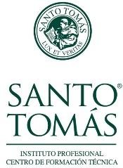

# Evaluación de empleabilidad

<!-- Copia de consulta derivada de ../originales/09_evaluacion_de_empleabilidad.docx. El DOCX original es la fuente canónica. -->

## PAUTA DE INSTRUCCIONES: INTEGRACION DE COMPETENCIAS II

## Actividad N°1

## Informe Reflexión Empleabilidad

## Resolución de Problemas

## Trabajo Colaborativo (Comunicación Efectiva)

### ANTECEDENTES GENERALES

| Nombre completo |   | Fecha de observación (dd/mm/aaaa) |   |
| --- | --- | --- | --- |
| Carrera/ Sede |   | Fecha de observación (dd/mm/aaaa) |   |
| Sección/ Jornada |   | Fecha de observación (dd/mm/aaaa) |   |

| Subcompetencia | CE2N2: Desarrollar software en base a los requerimientos del cliente velando por la calidad, seguridad y el cumplimiento de estándares de lenguajes y metodologías de desarrollo definidos en el proyecto informático. CEMN1 Participar colaborativamente en la resolución de problemas propios de su área de especialización, reconociendo cualidades innovadoras, gestionando sus recursos personales y de aprendizaje desde la perspectiva de la ética y las competencias de sello valórico institucionales. |
| --- | --- |
| Desempeño Clave | Resolución de problemas: Definir y analizar problemas generando estrategias para elegir la mejor solución. Trabajo colaborativo: Comunicar de manera efectiva con sus pares recepcionando la información relacionada a su actividad o función. |
| Tipo de evidencia / Evidencia | Reflexión respecto de la autogestión de conocimientos, tiempo y recursos vinculados a la resolución de problemas, trabajo colaborativo y comunicación efectiva |
| Metodología Activa | Metodología de Aprendizaje Basado en Proyectos. |

- INSTRUCCIONES Y FORMALIDADES

- Tipo de actividad: grupal (de 4 a 5 estudiantes)

- Duración de Evaluación: Semana 1 a la 6°

- Contexto: Horas de trabajo personal

- Se aplicarán sanciones establecidas en el Reglamento Académico en caso de detectar faltas a alguna de sus cláusulas

- Revisar documentos “Orientaciones al Trabajo Colaborativo” “Resolución de problemas” (cargado en el aula virtual)

- Analizar caso o proyecto entregado por el docente, respecto a la disciplina.

## Desarrollo

Empleabilidad HITO 2 etapa 1

Luego de la lectura y análisis del caso o proyecto dado, completen la matriz de informe, respondiendo a las siguientes preguntas:

| Etapas de análisis de problema Complicado | Síntesis del grupo |
| --- | --- |
| Indicar por qué es un problema complicado |   |
| Distinguir la estrategia utilizada para el Análisis del problema complicado |   |
| Identificar al menos tres posibles Causas (fundamentar) |   |
| Posibles soluciones (fundamentar la solución seleccionada) |   |

Empleabilidad HITO 2 etapa 1

Luego de haber efectuado el análisis de caso o proyecto, contesten las siguientes preguntas:

¿Qué beneficios se pueden obtener al establecer metas y objetivos comunes para un equipo? Mencionar al menos tres beneficios.

¿Qué acciones se pueden tomar para fomentar una comunicación efectiva dentro del equipo? Mencione al menos tres acciones.

¿Qué acciones se implementaron para promover la coordinación y el compromiso en el equipo? Mencione al menos tres acciones.

| Elementos de empleabilidad | Mis experiencias durante el desarrollo del Hito Integrador 2 |
| --- | --- |
| Beneficios de las metas y objetivos comunes. (describe 3 beneficios) |   |
| Acciones para fomentar la comunicación efectiva. |   |
| Acciones para promover la coordinación y el compromiso |   |

## Instrumento De Evaluación

- Revisar la rúbrica en el aula virtual, etapa 1, para saber cómo serás evaluado.

## Recursos gráficos incorporados

